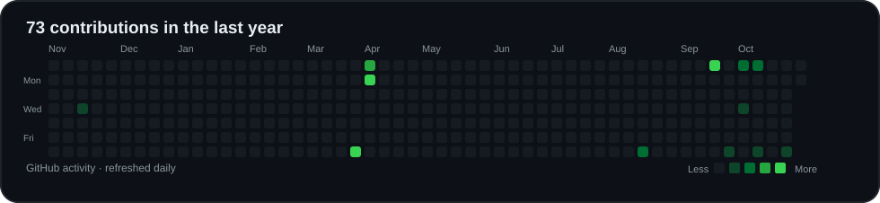

<div align="center">

<a href="https://wkroh.github.io/wkroh/profile-3d/" title="Open the interactive WKROH experience">
  
</a>

### Wkroh Dive / Developer in motion

**أبني أفكارًا جريئة، وأتعلم بسرعة، وأخلي الشغل يتكلم عني.**<br>
I turn curiosity into code and experiments into projects.

<a href="https://wkroh.github.io/wkroh/profile-3d/">🟢 Explore the interactive 3D experience</a> &nbsp;·&nbsp;
<a href="https://wkroh.github.io/wkroh/profile-3d/#arcade">🎮 Play Commit Rush</a> &nbsp;·&nbsp;
<a href="#selected-work">↘ Explore projects</a>

</div>

---

```text
wkroh@github:~$ whoami
Developer · creative coder · relentless learner

wkroh@github:~$ current_mission
Build the unexpected. Keep improving. Ship the next idea.
```

### `> git log --activity`

My real public contribution calendar, refreshed automatically from GitHub every day:

<a href="https://github.com/wkroh?tab=overview"></a>

<sup>Green squares represent GitHub contributions, including commits and other public activity. Select a day in the <a href="https://wkroh.github.io/wkroh/profile-3d/#activity">interactive version</a> for its exact count.</sup>

### Selected work

| Project | Inside |
|:--|:--|
| [**WKROH ↗**](https://github.com/wkroh/wkroh) | React + TypeScript web project, this profile and its interactive 3D experience. |
| [**NAFSS ↗**](https://github.com/wkroh/NAFSS) | JavaScript project from my public work. |
| [**Command-line games ↗**](https://github.com/wkroh/---CMD_python_games---) | Python games and experiments. |
| [**Pygame games ↗**](https://github.com/wkroh/---Pygame_games---) | Interactive experiments built with Pygame. |

<details>
<summary><b>▸ Open the developer console</b></summary>

```bash
git clone https://github.com/wkroh/wkroh.git
cd wkroh

# README artwork: assets/profile-hero.svg
# Live contribution data: profile-3d/contributions.json
# Interactive portfolio and mini game: profile-3d/
```

**Working with:** React · TypeScript · JavaScript · Python · Vite · Git

</details>

<div align="center">

<sub>Make it work. Make it better. Make it memorable.</sub>

</div>
